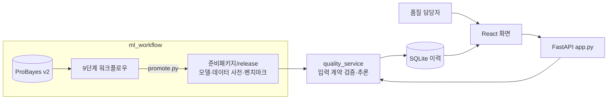

# 무한루프 · 사출성형 품질위험 검토 MVP

**제조공정 데이터 기반 품질위험 예측 및 공정편차 분석 MVP**

충청권 특화산업연계 수요기반 ICT 현장적용 프로젝트 · **과제 6**

**공개 체험:** [chungcheong-ict-quality.onrender.com](https://chungcheong-ict-quality.onrender.com) — 무료 서버라 첫 접속이 느릴 수 있습니다. 사출성형 버전은 병합 후 재배포합니다([문서 10](docs/10_공개_체험_배포.md)).

플라스틱 사출성형의 **사이클(부품) 단위 공정값**을 올리면, 먼저 검사할 부품과 학습 정상 범위를 벗어난 공정변수를 보여주는 웹 애플리케이션입니다. 모델은 별도의 **학습 워크플로우**(`ml_workflow/`)가 만들고, 승격 조건을 통과한 것만 서비스에 반영됩니다.

현재 단계는 **연구용 MVP**입니다. 공개 실험 자료 안에서 검증했으며, 실제 기업 현장 성능과 효과는 입증하지 않았습니다.

## 주요 기능

| 기능 | 구현 내용 |
|---|---|
| 업로드·항목 매핑 | UTF-8/CP949 CSV, xlsx, 미리보기, 원본 열 자동 제안, 라벨·사후측정 열 연결 차단 |
| 검증 | 중복 ID·날짜·숫자·허용 범위·필수 특징 결측 → 행별 오류, 선택 특징 결측은 학습 중앙값 대체 |
| 품질위험 예측 | 보정된 위험 점수, 2단계 검토 구분(우선 검토 / 통상 검토), 참고 구간 이탈 변수 |
| 사후 비교 | `actual_label`(0/1)이 있으면 예측과 비교 (예측 입력에는 쓰지 않음) |
| 분석 화면 | 공정변수 분포·구간별 불량 비율·영향도, 모델 선택 기록표·기준선·실험일 제외 진단 |
| 이력·내보내기 | SQLite 저장·검색·당시 결과 복원, 결과·오류 CSV |
| 학습 워크플로우 | 사후측정 자동 제외, 그룹 분할, 반복 그룹 CV, 4개 모델 비교, Gate 1·2, 리포트 자동 생성, 승격 |

## 시스템 구조



서비스는 특징·단위·허용 범위·결측 규칙을 코드에 두지 않고 `준비패키지/release/`에서 읽습니다. 새 모델은 학습 → 승격 → 서버 재시작으로 반영되며 서비스 코드를 고치지 않습니다. 설계: [문서 02](docs/02_시스템_설계서.md), [WORKFLOW.md](ml_workflow/WORKFLOW.md).

## 설치·실행 — Windows

Git과 **Python 3.12**를 준비한 뒤:

```powershell
git clone https://github.com/hjus36/chungcheong-ICT-quality.git
cd chungcheong-ICT-quality
powershell -ExecutionPolicy Bypass -File .\scripts\setup.ps1
powershell -ExecutionPolicy Bypass -File .\scripts\start.ps1
```

브라우저: **http://127.0.0.1:8765** · API 문서: **http://127.0.0.1:8765/docs** · 종료: `Ctrl+C` · 포트 변경: `start.ps1 -Port 8770`

빌드된 화면·모델·합성 예제가 저장소에 있어 Node.js와 원본 데이터 없이 실행됩니다. 화면 소스를 고칠 때는 Node.js 22.12+와 `setup.ps1 -RebuildFrontend`.

### 모델 다시 만들기

```powershell
powershell -ExecutionPolicy Bypass -File .\scripts\setup.ps1 -Train
# 원본: ml_workflow\data\README.md 대로 dataset_V2.parquet 받기
powershell -ExecutionPolicy Bypass -File .\scripts\train.ps1 -Run im_v3
powershell -ExecutionPolicy Bypass -File .\scripts\train.ps1 -Run im_v3 -Resume -Stages report -Promote
```

실행 결과와 자동 리포트는 `ml_workflow\runs\im_v3\`(git 제외). 절차: [문서 11](docs/11_데이터_재현과_저장소_운영.md).

### 5분 시연

1. 홈 → **합성 예제 결과 보기**: 120부품 분석 → 우선 검토 부품과 참고 구간 이탈 변수
2. **데이터 업로드 → 오류 포함 예제** → 검증에서 제외된 6행과 이유 확인 → 분석
3. 대시보드의 **가상 판정과 비교** (합성 라벨은 가상값)
4. **모델 검증**: XGBoost가 CV 점수는 높지만 Gate 2(처음 보는 실험일)에서 탈락한 이유
5. **분석 이력**에서 결과 복원, CSV 다운로드

## 입력 계약 (현재 모델)

| 열 | 필수 | 형식 |
|---|---|---|
| `part_id`, `cycle_start_at`, `cycle_end_at`, `data_source` | ✓ | 부품 ID, `YYYY-MM-DD HH:MM:SS`, `ProBayes_IM_v2` 또는 `synthetic_im` |
| `DXP_HoldingPressure1` | ✓ | 1단계 보압 실제값, bar, 0~5000 |
| `CALC_InjectionStroke` |  | 사출 스트로크, mm, 0~1000 (비면 대체) |
| `material`, `actual_label` |  | 재료, 실제 판정 0/1 |

단위 변환은 하지 않습니다. 기준 파일은 워크플로우가 생성한 `준비패키지/release/data_dictionary.json`이며 모델이 바뀌면 함께 바뀝니다. [문서 05](docs/05_API_DB_명세서.md), [문서 10 데이터 사전](docs/10_자료_출처와_데이터사전.md).

## 데이터

ProBayes 「Injection-Molding Production Data with Quality Labels」 v2 — SKZ·Fraunhofer IPA, EUDAT B2SHARE, 2022, DOI [10.23728/b2share.4c5692b886db419180f716acf895bf06](https://doi.org/10.23728/b2share.4c5692b886db419180f716acf895bf06), [CC BY 4.0](https://creativecommons.org/licenses/by/4.0/). 564 사출 사이클, 47개 실험 그룹, 불량(싱크마크 또는 미충전) 27.5%.

원본과 행 단위 파생 자료는 저장소에 넣지 않습니다. 공유 범위와 변경 내용 표기: [DATA_USAGE.md](DATA_USAGE.md).

## 모델과 평가 결과

**Logistic Regression, 특징 2개**(`DXP_HoldingPressure1`, `CALC_InjectionStroke`), 우선 검토 기준 **0.252**.

| 모델 | CV PR-AUC | Gate 1 | 실험일 제외 최소 Recall (Gate 2) | 결과 |
|---|---:|:-:|---:|---|
| **Logistic Regression** | 0.818 | ✓ | 0.50 | **선택** |
| XGBoost | 0.875 | ✓ | 0.00 | 탈락 |
| Random Forest | 0.800 | ✓ | 0.00 | 탈락 |
| SVM | 0.762 | ✗ | 0.00 | 탈락 |

| holdout 121부품 (개발 참고 평가) | 선택 모델 | 전부 우선 검토 |
|---|---:|---:|
| Recall / Precision | 1.00 / 0.60 | 1.00 / 0.30 |
| F2 / PR-AUC | 0.882 / 0.841 | 0.679 / 0.298 |
| TP / FN / FP / TN | 36 / 0 / 24 / 61 | 36 / 0 / 85 / 0 |

holdout은 규칙을 조정하면서 이미 본 자료이므로 **독립 검증이 아닙니다.** 선택 모델도 한 실험일에서 Recall 0.50으로 Gate 2 경계에 있습니다. [상세 벤치마크](docs/06_모델_벤치마크_보고서.md).

## 저장소 구조

```text
ml_workflow/              학습 워크플로우 — 설정(YAML), 단계별 코드, 승격·합성 예제, 테스트
  config/                 columns.yaml(사람 판단) · experiment.yaml(분석 기준) · release.yaml · synthetic.yaml
  data/README.md          원본 받는 법·해시 (데이터 파일은 git 제외)
  runs/                   실행 결과 (git 제외)
준비패키지/
  app.py                  FastAPI 진입점
  quality_service.py      입력 계약 검증·추론·SQLite 이력
  release/                승격된 모델·데이터 사전·공개 벤치마크·승격 기록
  share/                  합성 예제 (데모 120행, 오류 포함 업로드 예제, 생성 정의)
frontend/                 React 소스·빌드 dist·브라우저 테스트
scripts/                  setup · start · train · test (PowerShell), 공개 배포 패키지, 저장소 감사
tests/                    릴리스 무결성 · API · 공개 모드 · 서버 재시작
docs/                     기술문서 01~11
DATA_USAGE.md             데이터 출처·라이선스·공유 범위
```

## 테스트

```powershell
powershell -ExecutionPolicy Bypass -File .\scripts\test.ps1            # 릴리스 무결성, API 12, 공개 모드 4, 재시작
powershell -ExecutionPolicy Bypass -File .\scripts\test.ps1 -Workflow  # + 워크플로우 종단 7 (setup.ps1 -Train 필요)
```

브라우저 테스트(15개)는 서버를 8766에 띄운 뒤 `test.ps1 -Browser`. 결과: [문서 07](docs/07_검증_결과보고서.md).

## 기술 스택

| 영역 | 사용 기술 |
|---|---|
| Frontend | React 19.2.0, Vite 7.1.12, Recharts 3.3.0, Lucide React 0.468.0 |
| Backend | Python 3.12, FastAPI 0.162.0, Uvicorn 0.54.0, SQLite |
| ML | scikit-learn 1.9.1, XGBoost 3.4.1, joblib 1.6.0, NumPy 2.5.4, pandas 3.0.1 |
| 학습 전용 | PyYAML 6.0.4, PyArrow 26.0.1, Matplotlib 3.11.2 |
| 검증 | unittest, FastAPI TestClient, Playwright 1.56.1 |

버전은 [requirements-lock.txt](준비패키지/requirements-lock.txt), [requirements-train.txt](ml_workflow/requirements-train.txt), [pnpm-lock.yaml](frontend/pnpm-lock.yaml)에 고정했습니다.

## 기술문서

[01 요구사항](docs/01_요구사항_정의서.md) · [02 시스템 설계](docs/02_시스템_설계서.md) · [03 데이터·AI 설계](docs/03_데이터_AI_설계서.md) · [04 개발 현황·계획](docs/04_개발계획서.md) · [05 API·DB](docs/05_API_DB_명세서.md) · [06 모델 벤치마크](docs/06_모델_벤치마크_보고서.md) · [07 기술검증](docs/07_검증_결과보고서.md) · [08 사용자 설명서](docs/08_사용자_설명서.md) · [09 최종 결과](docs/09_최종_결과보고서.md) · [10 공개 체험 배포](docs/10_공개_체험_배포.md) · [10 자료 출처·데이터 사전](docs/10_자료_출처와_데이터사전.md) · [11 재현·저장소 운영](docs/11_데이터_재현과_저장소_운영.md) · [워크플로우 설계](ml_workflow/WORKFLOW.md)

## 한계와 다음 단계

실험 계획으로 만든 자료라 독립 표본이 사실상 47개 실험 조건이고, 학습 자료의 실험일은 3개뿐입니다. 새 실험일이나 실제 생산 자료로 규칙을 고정한 독립 검증, 기업 공정 담당자와의 측정 시점·단위·규격 확인, MES 연계는 후속 과제입니다. 이전 버전(KAMP 열처리·SECOM)은 git 이력에 남아 있습니다.
