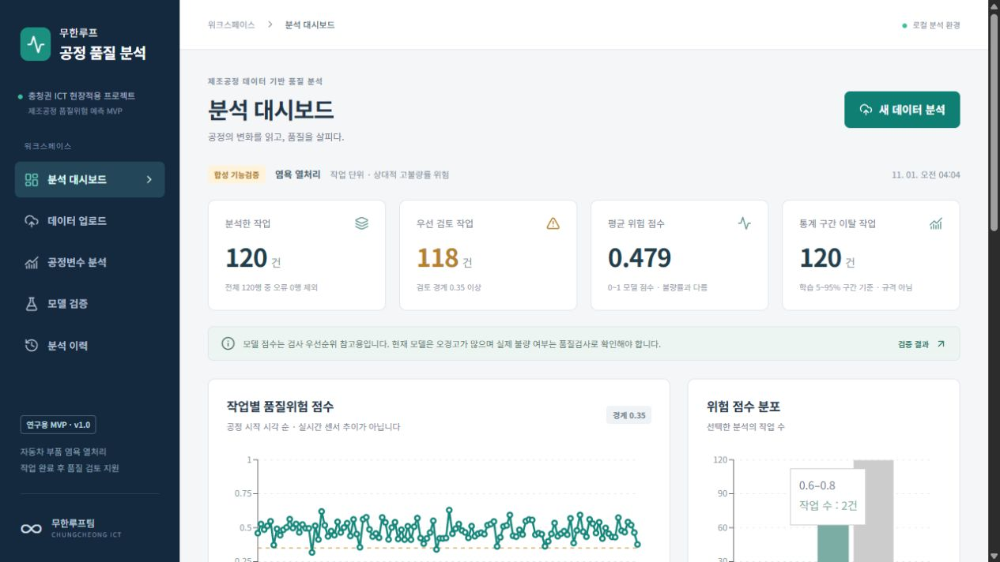
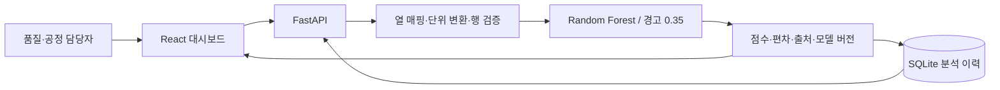

# 무한루프 · 제조공정 품질 분석 MVP

**제조공정 데이터 기반 품질위험 예측 및 공정편차 분석 MVP**

충청권 특화산업연계 수요기반 ICT 현장적용 프로젝트 · **과제 6**

제조 현장의 흩어진 공정 기록을 작업 단위로 정리하고, 품질·공정 담당자가 검토할 작업과 통계적 편차를 함께 확인하는 로컬 웹 애플리케이션입니다. CSV/Excel 업로드부터 항목 매핑, 모델 추론, 대시보드, SQLite 이력 저장까지 연결했습니다.

현재 단계는 **기능 구현과 기술검증을 마친 연구용 MVP**입니다. **실제 제조 현장에서 신뢰할 수 있는 품질판정 성능은 입증하지 못했습니다.** 작업이 끝난 뒤 전체 구간의 집계값을 사용하므로 실시간 조기예측이 아닙니다. 출하판정과 설비 제어를 수행하지 않습니다.

## 주요 기능

| 기능 | 구현 내용 |
|---|---|
| 업로드·항목 매핑 | UTF-8/CP949 CSV, xlsx 첫 시트, 미리보기, 원본 열과 공통항목 연결 |
| 검증·전처리 | 중복·결측·날짜·수치·품질수량 확인, 명시적 단위 변환, 오류행 제외 |
| 품질위험 예측 | 저장된 RF 모델의 실제 추론, 작업별 점수·검토 우선순위 |
| 공정변수·편차 분석 | 입력값·대체값·변환값, 학습 분포와 참고 구간, 변수 관계와 기여도 |
| 웹 대시보드 | 작업 목록·검색·필터·상세, 점수 차트·모델 비교·혼동행렬 |
| 이력·내보내기 | SQLite 저장·검색·당시 결과 복원, 결과 및 오류 CSV 다운로드 |

저장소 배포본은 독립 난수로 만든 **합성 예제**를 제공합니다. KAMP 실측 원본이나 작업별 가공자료 없이도 업로드→분석→저장 흐름을 실행할 수 있습니다. 실측자료를 로컬에 갖춘 환경의 기능은 유지합니다.



위 수치는 합성 예제의 기능 시험 결과이며 모델 정확도 평가가 아닙니다.

## 기술 스택

| 영역 | 실제 사용 기술 |
|---|---|
| Frontend | React 19.2.0, Vite 7.1.12, Recharts 3.3.0, Lucide React 0.468.0 |
| Backend | Python 3.12, FastAPI 0.162.0, Uvicorn 0.54.0 |
| Database | Python 표준 sqlite3 / 로컬 SQLite |
| AI/ML | scikit-learn 1.9.1, XGBoost 3.4.1, joblib 1.6.0 |
| 데이터 처리 | NumPy 2.5.4, pandas 3.0.1, openpyxl 3.1.5 |
| 검증 | unittest, FastAPI TestClient, Playwright 1.56.1 |
| 검증한 환경 | Windows, Python 3.12.14, Node.js 24.22.1, pnpm 11.25.0 |

전체 Python 버전은 [requirements-lock.txt](준비패키지/requirements-lock.txt), 프런트 의존성은 [package.json](frontend/package.json)과 [pnpm-lock.yaml](frontend/pnpm-lock.yaml)에 고정했습니다.

## 시스템 구조



FastAPI가 빌드된 React 화면과 API를 같은 주소에서 제공합니다. 외부 API Key나 클라우드 계정은 필요하지 않습니다. 이력 조회는 저장 당시 JSON을 복원하며 새 모델로 임의 재계산하지 않습니다.

## 설치·실행 — Windows

Git과 **Python 3.12**를 준비합니다. Private 저장소 접근 권한이 있는 팀원 계정으로 Clone하세요.

```powershell
git clone https://github.com/hjus36/chungcheong-ICT-quality.git
cd chungcheong-ICT-quality
powershell -ExecutionPolicy Bypass -File .\scripts\setup.ps1
powershell -ExecutionPolicy Bypass -File .\scripts\start.ps1
```

브라우저: **http://127.0.0.1:8765** · API 문서: **http://127.0.0.1:8765/docs**

종료: 서버 터미널에서 `Ctrl+C`. 포트 변경: `start.ps1 -Port 8770`.

Python 자동 탐색이 안 되면 `setup.ps1 -PythonExe "Python312\python.exe의 실제 경로"`로 지정합니다. 최초 패키지 설치에는 인터넷이 필요합니다. **빌드된 화면·모델·합성 예제가 포함되어 일반 시연에는 Node.js, 원본 다운로드, 모델 재학습이 필요하지 않습니다.** SQLite 파일은 처음 실행할 때 생성되며 기존 개인 이력은 배포하지 않습니다.

화면 소스를 수정할 개발자는 Node.js 22.12 이상(검증 환경은 24.22.1)과 pnpm 11.25.0 또는 npm/npx를 준비합니다.

```powershell
powershell -ExecutionPolicy Bypass -File .\scripts\setup.ps1 -RebuildFrontend
# 백엔드를 8765에서 실행한 상태에서 프런트 개발 서버 실행
cd frontend
pnpm dev
```

### 5분 시연

1. **합성 예제로 시작** 또는 **데이터 업로드 → 합성 예제 불러오기**를 선택합니다.
2. 필수 40항목 연결과 단위를 확인하고 **데이터 검증**을 누릅니다.
3. **120행 분석 및 저장**으로 대시보드와 작업 상세를 확인합니다.
4. 공정변수·모델 검증 화면에서 통계 관계와 낮은 모델 성능을 함께 확인합니다.
5. 분석 이력에서 저장 결과를 복원하고 결과 CSV를 내려받습니다.

가상 품질수량은 **가상 불량률**로 표시합니다. 합성 예제의 결과로 모델 정확도를 주장하지 않습니다. 실측 예제 버튼은 해당 로컬 파일을 별도 확보한 경우에만 활성화됩니다. 자세한 조작은 [사용자 설명서](docs/08_사용자_설명서.md)를 참고하세요.

## 입력 계약

- 한 행은 완료된 작업/LOT 한 개. 최대 10MiB, 10,000행, 100열.
- 필수: 작업 ID·시작/종료 시각·출처와 18센서의 평균/표본 표준편차 **36특성**.
- 온도는 °C, OP/CP는 %. °F/K/fraction 입력은 사용자가 명시한 경우에만 변환합니다.
- 선택 품질수량은 사후 비교용이며 예측 입력에서 제외합니다.
- 특성 결측은 최대 3개까지 학습 중앙값으로 대체합니다. 더 많은 결측·중복 ID·잘못된 값은 행별 오류로 표시합니다.
- 실측과 합성, 서로 다른 공정의 데이터는 같은 파일에 섞지 않습니다.

정확한 필드명은 [데이터 사전](docs/데이터사전.json)과 [API·DB 명세](docs/05_API_DB_명세서.md)에 있습니다. 학습 5~95% 통계 구간은 기업 규격이 아니며, 모델 위험 점수는 실제 불량률 또는 보정된 불량 확률이 아닙니다.

## 데이터셋과 공유 범위

| 자료 | 구성 | 활용 |
|---|---|---|
| KAMP 열처리 품질보증 | 자동차 부품 염욕 열처리, 센서 **2,939,722행**, 품질 결과가 연결된 **136작업** | 서비스 모델 학습·평가. 센서행을 독립 정답 수로 세지 않음 |
| UCI SECOM | 반도체 생산 **1,567개체**, 숫자 신호 590열, 검사 실패 104건 | 별도 공정의 모델 비교. 제공처 설명 591특성과 실제 파일 590열 차이를 기록 |
| 공유용 합성 예제 | 가상 작업 120행, 테스트용 20행 | 독립 난수로 생성한 기능 시험자료. 학습·성능평가 제외 |

**KAMP와 SECOM은 통합 학습하지 않았습니다.** SECOM은 열처리 모델의 외부 검증 자료가 아닙니다. KAMP의 136작업도 같은 설비에서 수집되어 작업 사이의 완전한 통계적 독립성을 확인하지 못했습니다.

KAMP 출처: 중소벤처기업부, KAMP, 「열처리 품질보증 AI 데이터셋」, 스마트제조혁신추진단(㈜임픽스), 2022.12.23. [공식 다운로드 안내](https://www.kamp-ai.kr/aidataDetail?DATASET_SEQ=60).

SECOM 출처: McCann, M. & Johnston, A. (2008). [SECOM, DOI 10.24432/C54305](https://doi.org/10.24432/C54305), UCI, [CC BY 4.0](https://creativecommons.org/licenses/by/4.0/).

KAMP 원본·작업별 가공 CSV·개인화 가이드북, SECOM 원본 ZIP/행렬/라벨, 개인 DB, 공식 평가·신청·면담 문서, 가상환경·캐시는 Git에서 제외합니다. 학습 모델과 집계 평가·통계는 포함하며, 배포본 관계 차트는 최소 5작업으로 묶은 평균을 표시합니다. 상세 조건과 과거 이력에 남은 자료는 [데이터 공유 정책](DATA_USAGE.md)에 명시했습니다.

원본을 별도 확보해 연구를 재현하는 절차는 [데이터 재현 안내](docs/11_데이터_재현과_저장소_운영.md)에 있습니다.

## 모델과 실제 평가 결과

현재 서비스 모델은 **Random Forest**, 경고 기준은 **0.35**입니다. 라벨은 학습 불량률 Q3인 약 0.049443% 이상인 상대적 위험이며 기업의 합격·불합격 기준이 아닙니다. 학습 78 / 검증 22 / 보류 36작업을 시간순으로 나눴습니다.

| 기존 보류 36작업 | 결과 |
|---|---:|
| Recall / Precision | 71.4% / 17.9% |
| F1 / F2 | 0.2857 / 0.4464 |
| ROC-AUC / AP | 0.4286 / 0.2055 |
| TP / FN / FP / TN | 5 / 2 / 23 / 6 |
| 전부 경고하는 기준선 F2 | **0.5469** |

기존 보류자료는 이미 확인한 개발 참고 평가입니다. 새로운 독립 검증이 아닙니다. 현재 모델은 전부 경고하는 기준선보다 F2가 낮아 무인 품질판정이나 현장 경고 운영에 충분하다고 볼 수 없습니다.

### 추가 성능 개선 실험

`experiments/quality_20261101/`에서 공정 관계 16개와 원본 시간특성 35개를 설계하고, LR/RF/XGBoost **18후보와 기존 RF 대조군**을 비교했습니다. 최고 시간순 CV 후보는 5월 검증에서 AP **0.3770 → 0.2290**, F2 **0.6061 → 0.3846**으로 악화되어 **기존 모델을 유지**했습니다.

SECOM은 별도 6후보를 비교했습니다. 선정 XGBoost의 마지막 시간 보류 380개체에서 AP 0.0889, Recall 4.3%로 실용 성능을 확보하지 못했습니다. 결과를 본 뒤 보류자료로 후보나 경계를 다시 고르지 않았습니다.

[상세 벤치마크](docs/06_모델_벤치마크_보고서.md) · [실험 코드·재현 설명](experiments/quality_20261101/README.md) · [전체 검증 비교표](experiments/quality_20261101/results/all_validation_comparisons.csv)

## 저장소 구조

```text
frontend/                 React 소스·설정·lockfile·빌드 dist·브라우저 테스트
준비패키지/
  app_kamp.py              현재 FastAPI 진입점
  quality_service.py       검증·단위변환·추론·SQLite 이력
  prepare_kamp.py          원본 센서 집계·품질표 연결
  train_release.py         기존 서비스 모델 학습 절차
  kamp/release/            현재 모델·집계 벤치마크
  kamp/share/              재배포용 독립 난수 합성 예제
  data/, models/, results/ 과거 강구 합성 데모 기록
experiments/quality_20261101/
                          개선 코드·프로토콜·집계결과·선정후보·출처
docs/                     기술문서 01~11·데이터 사전·검증 기록
scripts/                  설치·실행·테스트·공유자료 생성·저장소 감사
tests/                    API·자료 무결성·재시작 검증
DATA_USAGE.md             공유 범위·데이터 이용조건·과거 이력 안내
```

`app.py`, 과거 `data/models/results`, 초기 모델은 보존된 연구 기록입니다. **현재 실행 진입점은 `scripts/start.ps1`과 `app_kamp.py`**입니다. 새 Clone에는 로컬 전용 원본·보존 사본·중복 후보 파일이 포함되지 않습니다.

## 테스트와 검증

| 구분 | 검증 범위 |
|---|---|
| 최초 MVP | API 11개, 브라우저 11시나리오, 프로세스 재시작, 원본 해시·작업 연결 |
| 모델 개선 실험 | 실험 검증 8개, API 11개 재검증, 재집계 재현, 브라우저 주요 흐름 |
| 이번 저장소 정리 | 원본 없는 배포 구성의 새 설치, API 12개·실제 서버 재시작·주요 화면 검증 |

최신 실제 결과는 [기술검증 보고서](docs/07_검증_결과보고서.md)와 `docs/verification/repository/`에 기록합니다. 과거 전체 브라우저 테스트와 이번 주요 흐름 확인은 구분합니다. 테스트 통과는 모델의 현장 정확도를 증명하지 않습니다.

```powershell
powershell -ExecutionPolicy Bypass -File .\scripts\test.ps1
.\.venv\Scripts\python.exe tests\verify_restart.py
```

브라우저 자동 회귀는 프런트 개발 의존성과 Edge가 필요합니다. 별도 DB 서버를 띄운 뒤 `node frontend/tests/e2e.mjs`로 실행합니다. 상세 명령은 [저장소 운영 안내](docs/11_데이터_재현과_저장소_운영.md)에 있습니다. 원본 검증·학습 재현은 별도 데이터 확보가 필요하며 기본 Clone 테스트와 구분합니다.

## 기술문서

[01 요구사항](docs/01_요구사항_정의서.md) · [02 시스템 설계](docs/02_시스템_설계서.md) · [03 데이터·AI 설계](docs/03_데이터_AI_설계서.md) · [04 개발 현황·계획](docs/04_개발계획서.md) · [05 API·DB](docs/05_API_DB_명세서.md)

[06 모델 벤치마크](docs/06_모델_벤치마크_보고서.md) · [07 기술검증](docs/07_검증_결과보고서.md) · [08 사용자 설명서](docs/08_사용자_설명서.md) · [09 최종 결과](docs/09_최종_결과보고서.md) · [10 출처·데이터 사전](docs/10_자료_출처와_데이터사전.md) · [11 재현·저장소 운영](docs/11_데이터_재현과_저장소_운영.md)

## 한계와 다음 단계

독립 품질 정답이 적고 제품·재질·검사시각·기업 규격이 부족합니다. 새 기업의 열처리 품질자료, 실제 예측 시점 이전의 센서구간, 공정별 재학습과 시간·그룹 분할 검증이 필요합니다. 현장 담당자와 미탐 비용·검토 가능한 작업 수를 정한 뒤 모델과 경고 기준을 다시 평가해야 합니다.

실제 기업 설비/MES 연결, 현장 사용자 평가, 불량 감소 효과, 외부 운영 배포는 완료하지 않았습니다. 현재 저장소는 **Private로 유지**하며 이력 재작성이나 Force Push 없이 관리합니다.
