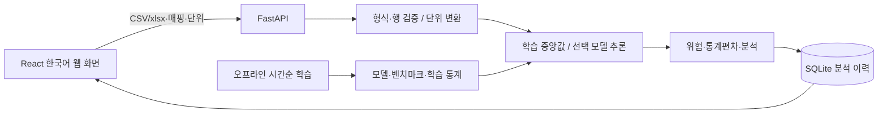

# 시스템 설계서

2026-11-01 · 현재 구현을 기준으로 작성. FastAPI/Python/SQLite와 저장된 모델을 사용한다.

Frontend는 React+Vite, Backend는 기존 `준비패키지/app_kamp.py`를 진입점으로 사용한다. 업무 로직은 `quality_service.py`, 학습은 새 `train_release.py`로 분리한다. 기존 원본·기존 모델은 덮어쓰지 않고 새 모델은 `kamp/release/`에 저장한다. 정적 빌드는 FastAPI가 같은 출처에서 제공하며 별도 클라우드나 로그인은 필요하지 않다.

## API 계약

| 메서드·경로 | 역할 |
|---|---|
| GET /health | 상태·모델 범위 |
| GET /schema | 메타·36특성·단위·선택 품질항목·제한 |
| GET /model | 모델 비교·한계·변수 분석 |
| GET /sample?kind=real 또는 synthetic | 명시된 출처의 시연 CSV |
| POST /preview | 파일 열·타입·표본·행 수·해시 |
| POST /validate | 파일+mapping JSON+units JSON → 유효/오류행·대체·변환 요약 |
| POST /predict | 동일 입력 재검증→추론→트랜잭션 저장 |
| GET /runs | 페이지·검색·자료 구분을 적용한 이력 목록 |
| GET /runs/{id} | 저장된 예측 전체 재현 |
| GET /runs/{id}/export | 결과 또는 오류 CSV |

업로드는 요청마다 재검증한다. 프런트에서 검증 결과가 있더라도 입력 매핑·단위가 바뀌면 이전 검증을 무효화한다. 서버에 임의 경로/모델 업로드 기능은 없다. 손상 파일/잘못된 매핑은 422, 형식 미지원 415, 크기 초과 413, 없는 이력 404로 응답한다. 동일 요청 중복 실행은 UI에서 방지하되 동일파일 재분석 자체는 허용한다.

## 데이터 저장과 버전

기존 `kamp/runs.sqlite3`의 `runs(id TEXT PRIMARY KEY,payload TEXT NOT NULL)`를 유지한다. 필요한 메타 열(생성시각·파일명·자료범위·모델버전·행 수)을 비파괴 마이그레이션한다. 과거 payload의 부족한 필드는 빈 값으로 남기며 새 기록과 구분한다. 결과 JSON을 기록 당시의 스냅샷으로 저장해 모델 업데이트 후에도 기존 결과를 바꾸지 않는다. SQLite busy timeout·WAL과 매개변수 쿼리를 적용한다. 테스트는 임시 DB를 사용한다.

결과에는 run_id, 입력 SHA-256, 파일명, 생성시각, 모델버전/해시, 자료 구분, 매핑/단위 설정, 유효·오류행, 위험 점수, 검토 구분, 실제 불량률(제공된 경우), 누락 대체, 36특성, 참고범위 이탈이 포함된다. 원본 업로드 파일 자체는 보존하지 않는다.

## 실행과 제약

Windows PowerShell 설치 스크립트가 가상환경을 준비하며 저장소에 프런트 빌드를 포함한다. 실행은 로컬 127.0.0.1:8765. 다중 사용자 인증·외부 공개·권한 분리·운영 백업은 현장 도입 전 별도 과제이다. API 및 DB 세부 구현 계약은 `05_API_DB_명세서.md`에 기록했다.

GitHub Clone 환경은 독립 합성 예제와 `benchmark_public.json`을 사용한다. 품질 관계도는 최소5작업 집단 평균으로 표시한다. 로컬 실측 예제와 기존 상세 벤치마크가 있으면 이를 우선 사용하며, `/schema`의 `sample_availability`로 예제 버튼 상태를 결정한다. 모델·임계값·입력 계약·저장된 이력은 변경하지 않는다.
