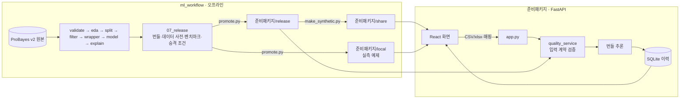

# 시스템 설계서

2026-11-21 · 현재 구현 기준.

## 구성 요소

| 구성 | 위치 | 역할 |
|---|---|---|
| 학습 워크플로우 | `ml_workflow/` | 데이터 점검부터 모델 선택·승격 후보 생성까지. 설계: [WORKFLOW.md](../ml_workflow/WORKFLOW.md) |
| 승격 | `ml_workflow/promote.py` | 승격 조건·해시 확인 후 `준비패키지/release/`로 복사, 이전 버전 보관 |
| 서비스 계약 | `준비패키지/release/` | `model.joblib`(번들), `data_dictionary.json`, `benchmark_public.json`, `release_check.json`, `release_info.json` |
| 백엔드 | `준비패키지/app.py`, `quality_service.py` | 업로드·검증·추론·이력. 특징·단위·범위·결측 규칙은 코드에 하드코딩하지 않고 release에서 읽음 |
| 프런트 | `frontend/` | React 19 + Vite 빌드, FastAPI가 같은 주소에서 제공 |
| 이력 | SQLite (`ICT_DB_PATH`) | 결과 JSON을 저장 당시 그대로 보관 |
| 실측 예제 | `준비패키지/local/` (git 제외) | 승격 때 원본 holdout 행을 업로드 형식으로 복사. 웹 '실측 예제 불러오기'가 사용 |
| 원본 변환 | `ml_workflow/make_upload.py` | 원본 데이터셋 파일 → 업로드 형식 CSV |

새 모델로 바꿀 때 서비스 코드를 고치지 않는다. 학습 → 승격 → 서버 재시작 순서이며, 특징 수나 이름이 바뀌어도 화면과 검증 규칙이 데이터 사전을 따라간다.

## API 계약

| 메서드·경로 | 역할 |
|---|---|
| GET /health | 상태, 모델 버전, 자료 범위 |
| GET /schema | 필수·선택 항목, 특징별 단위·허용 범위·설명·참고 구간, 결측 정책, 금지 접두사, 제한 |
| GET /model | 공개 벤치마크(선택 기록표, holdout, 기준선, 실험일 제외 진단, 변수 분석) |
| GET /sample?kind=synthetic\|test\|real | 합성 예제 / 오류 행 포함 예제 / 로컬 실측 예제 |
| POST /preview | 파일 열·표본·인코딩·해시·제안 매핑 |
| POST /validate | 파일 + mapping JSON → 유효/오류 행, 결측 대체 요약 |
| POST /predict | 재검증 → 추론 → 저장 → 전체 결과 |
| GET /runs, /runs/{id}, /runs/{id}/export | 이력 목록·단건·CSV |

세부 필드는 [05 API·DB 명세](05_API_DB_명세서.md).

## 판정과 표시

- 위험 점수: 확률 보정(sigmoid)한 모델 출력.
- 우선 검토: 점수 ≥ `alert_threshold`(현재 0.252, dev 반복 CV 예측에서 Recall 0.90 지점). 그 외 통상 검토.
- 품질주의 기준(0.042, Recall 0.98 지점)은 번들에만 저장하고 화면은 2단계로 표시한다.
- 참고 구간 이탈: 입력값이 학습 정상 부품 5~95백분위 밖이면 표시. 결측 대체값은 이탈 판정에서 제외한다.

## 실행 환경

| 구분 | 내용 |
|---|---|
| 로컬 | Windows PowerShell 스크립트, Python 3.12.14 고정 lock, 포트 8765 |
| 공개 체험 | Render 무료 인스턴스, `ICT_PUBLIC_DEMO=1`(합성 예제만, 500행, 이력 20건) — [문서 10](10_공개_체험_배포.md) |
| 학습 | 같은 lock + `ml_workflow/requirements-train.txt` (pyyaml, pyarrow, matplotlib) |
